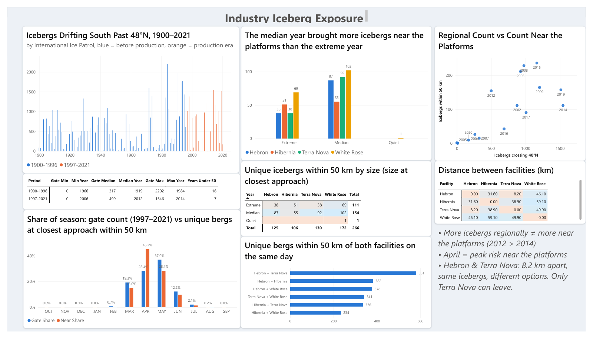
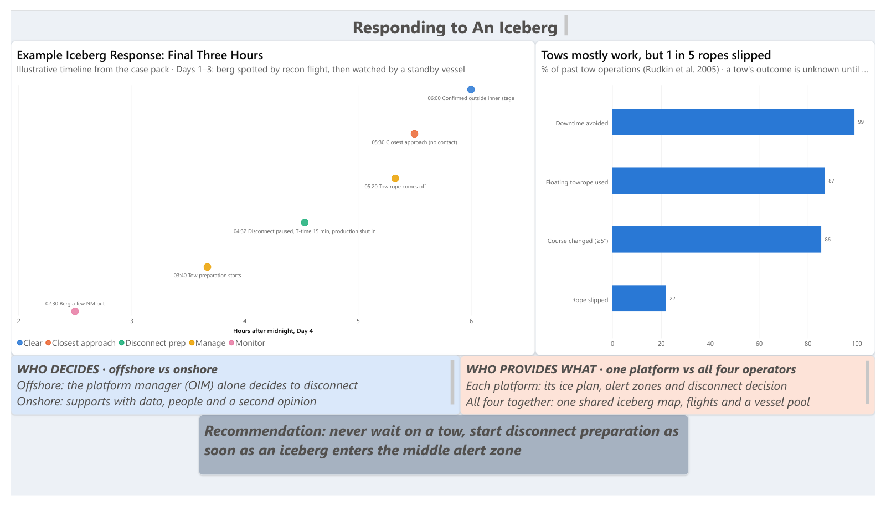
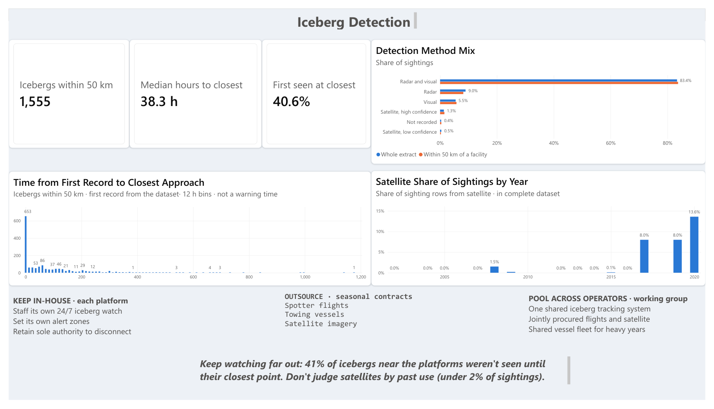
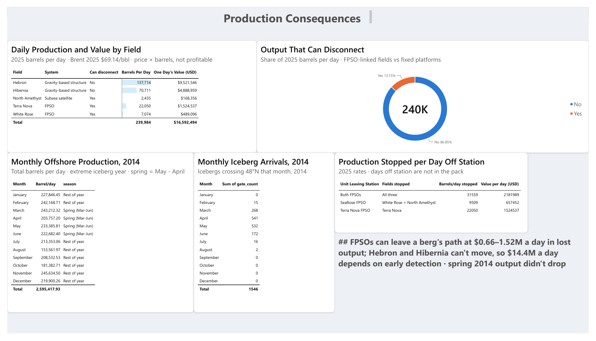
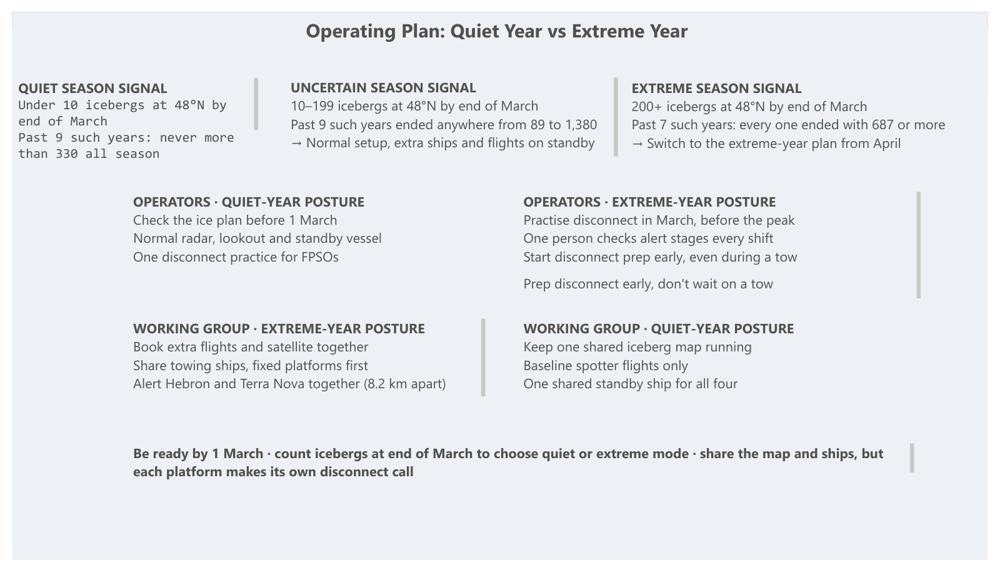

# Grand Banks Iceberg Risk

**Ready by March: planning for both quiet and extreme iceberg years at Newfoundland's four offshore oil platforms.**

Team 5's entry for the CPA DnA Case Competition 2026 (October 24–25, 2026). We used historical iceberg sightings and production data to show how Hibernia, Hebron, Terra Nova and White Rose spot, tow and avoid icebergs, and we built a simple March 31 rule for planning each spring season.

**Tools:** Python (Jupyter) for data cleaning and analysis · Power BI for the dashboard · PowerPoint for the presentation

---

## The question

The number of icebergs that drift south past 48°N changes a lot from year to year. Since production began in 1997, it has ranged from **0** (2006) to **1,546** (2014), with a median of **499** (2012). How should the four platforms prepare when they don't know in advance which kind of year is coming?

## Two kinds of platform

| Field | Platform type | Can it move away? | Barrels/day (2025) | One day's value |
|---|---|---|---:|---:|
| Hebron | Fixed concrete (GBS) | No | 137,714 | $9.52M |
| Hibernia | Fixed concrete (GBS) | No | 70,711 | $4.89M |
| Terra Nova | Floating ship (FPSO) | Yes | 22,050 | $1.52M |
| White Rose + North Amethyst | Floating ship (SeaRose FPSO) | Yes | 9,509 | $0.66M |
| **Total** | | | **239,984** | **$16.59M** |

The two fixed platforms carry **86.85%** of output. They can't move, so they have to spot icebergs early and tow them away. The floating ships can disconnect from the wells and sail off, on a timed countdown.

Values are 2025 production at the 2025 average Brent price ($69.14/bbl). They show gross revenue, not profit.

## Key findings

1. **More icebergs in the ocean doesn't mean more near the rigs.** The extreme year (2014) had **111** icebergs come within 50 km of a platform. The median year (2012) had **154**.
2. **Danger near the rigs peaks in April**, when 45% of close approaches happen. That's one month before the peak of icebergs crossing 48°N in May.
3. **Platforms share the threat.** On **581** occasions, the same iceberg came within 50 km of both Hebron and Terra Nova on the same day. The two are 8.2 km apart, and Terra Nova can sail away but Hebron can't.
4. **Towing works, but not every time.** In past tow operations (Rudkin et al., 2005), 86% changed the iceberg's course and 99% avoided downtime, but **22% of tow ropes slipped**.
5. **Many icebergs show up late.** Of the **1,555** icebergs that came within 50 km of a platform, **40.6%** had no earlier sighting in the log: their first record was already their closest point. The median time from first record to closest point was 38.3 hours.
6. **Satellites are filling the gap.** Most sightings still come from radar and visual watch (83.4%). Radar satellites, which see through fog and cloud, rose from almost none before 2017 to 13.6% of sightings in 2020.
7. **Production held in the extreme year.** In spring 2014 (March–June), output averaged 225.8K bbl/d, compared with 211.5K bbl/d for the rest of the year. The low point (153.6K bbl/d in August) came from planned maintenance, not ice.

## Recommendation: be ready by March 1, decide on March 31

At the end of March, count the icebergs that have crossed 48°N and choose the plan for the season. Past years show how well that early count predicts the full season:

| Signal at end of March | What past years show | Response |
|---|---|---|
| **Quiet:** fewer than 10 icebergs | 9 such years, none above 330 for the whole season | One shared iceberg map, baseline spotter flights and one shared standby ship for all four platforms. |
| **Uncertain:** 10–199 icebergs | 9 such years, ending anywhere from 89 to 1,380 | Normal setup, with extra ships and flights on standby. |
| **Extreme:** 200+ icebergs | 7 such years, every one ending at 687 or more | Switch to the extreme-year plan from April. Book flights and satellite imagery together, share towing ships with the fixed platforms served first, and alert Hebron and Terra Nova together. |

Rules that apply in every year:

- **Never wait on a tow.** The floating platforms should start preparing to disconnect as soon as an iceberg enters the middle alert zone, even while a tow is under way.
- **Share, but keep the final call local.** All four platforms share one iceberg map, flights and a vessel pool. Each platform's Offshore Installation Manager (OIM) alone decides whether to disconnect.
- **Split the work three ways:**
  - Each platform keeps its own 24/7 iceberg watch and alert zones in-house.
  - Spotter flights, towing vessels and satellite imagery are hired on seasonal contracts.
  - The four operators run one shared tracking system, buy flights and satellite imagery together, and share a vessel fleet for heavy years.

## Dashboard tour

The Power BI report has five pages. Page 1 is shown at the top of this README.

| Page | What it shows |
|---|---|
| 1. Industry Iceberg Exposure | 122 years of iceberg counts, the monthly pattern, close approaches per platform, and the distances between platforms. |
| 2. Responding to an Iceberg | A sample hour-by-hour response, how often tows work, and who makes each decision. |
| 3. Iceberg Detection | How icebergs are spotted, how much warning the log gives, and the rise of satellite sightings. |
| 4. Production Consequences | Daily output and value per field, what each platform loses per day off station, and 2014 month by month. |
| 5. Operating Plan | The March 31 signal and the quiet-year and extreme-year plans for operators and for the shared working group. |

<b>Page 2: Responding to an Iceberg</b>

<b>Page 3: Iceberg Detection</b>

<b>Page 4: Production Consequences</b>

<b>Page 5: Operating Plan</b>

## Data sources

All data came from the competition's case data pack. The organisers prepared the files from these sources:

| Data | Years | Used for | Source |
|---|---|---|---|
| Monthly count of icebergs drifting south of 48°N | 1900–2021 | Long-run history, monthly pattern, March 31 rule | International Ice Patrol, [IIP Count of Icebergs South of 48 Degrees North](https://nsidc.org/data/g10028) (NSIDC) |
| Iceberg sightings near the platforms, with position, size, shape and detection method | 2002–2020 | Close approaches, shared threats, detection | International Ice Patrol, [IIP Iceberg Sightings Database](https://nsidc.org/data/g00807) (NSIDC, [doi:10.7265/N56Q1V5R](https://doi.org/10.7265/N56Q1V5R)) |
| Oil production by field (yearly) and for the whole offshore area (monthly) | 2002–2025 | Daily output and value, 2014 production | Canada-Newfoundland and Labrador Offshore Energy Regulator (C-NLOER, formerly C-NLOPB), [production statistics](https://www.cnlopb.ca/information/statistics/) |
| Brent crude annual average price | 2002–2026 | Value of one day's production | Prepared by the organisers |
| Platform locations, platform type and first-oil dates | — | Distances between platforms, which platforms can disconnect | Prepared by the organisers |
| FPSO iceberg response guide and example disconnect timeline | — | Page 2 response timeline | Prepared by the organisers |
| Outcomes of past iceberg tows | About 30 years, up to 2005 | How often tows work | Rudkin, P., Young, C., Barron Jr., P. & Timco, G. (2005). [*Analysis and results of 30 years of iceberg management*](https://openpolar.no/Record/ftnrccanada:oai:cisti-icist.nrc-cnrc.ca:cistinparc:12327552). |

The raw data files aren't included in this repo. For anything the pack didn't credit by name, the source shown is the public dataset the file matches.

## Method

- **Reference years:** from the production era (1997–2021), we picked a quiet year (2006), a median year (2012) and an extreme year (2014).
- **Close approach:** each unique iceberg's nearest recorded point to a platform, counted when it was within 50 km.
- **Cleaning:** done in Python, with every data change written down so that each count, join and assumption could be defended.
- **Dashboard:** the cleaned data feeds the Power BI report.

## What's in this repo

| File | What it is |
|---|---|
| [`iceberg-risk-dashboard.pdf`](iceberg-risk-dashboard.pdf) | All five dashboard pages as a PDF. You can view it right on GitHub. |
| [`iceberg-risk-dashboard.pbix`](iceberg-risk-dashboard.pbix) | The interactive Power BI file. Open it with [Power BI Desktop](https://www.microsoft.com/power-platform/products/power-bi/desktop), which is free on Windows. |
| [`iceberg-risk-slides.pdf`](iceberg-risk-slides.pdf) | Presentation slides. You can view these right on GitHub. |
| [`iceberg-risk-slides.pptx`](iceberg-risk-slides.pptx) | The same slides as an editable PowerPoint file. |
| [`images/`](images/) | Each dashboard page as an image, used in this README. |

## Team

This was a team project. I'm grateful to my collaborators:

- **Varvara Korotnytska**
- **Mitchell Delaney**
- **Fayez Faruk**

Repo maintained by Rakib Hossain ([@mridul0837](https://github.com/mridul0837)).

---

*This is student competition work. It isn't operational guidance, and we have no connection to the platform operators.*
